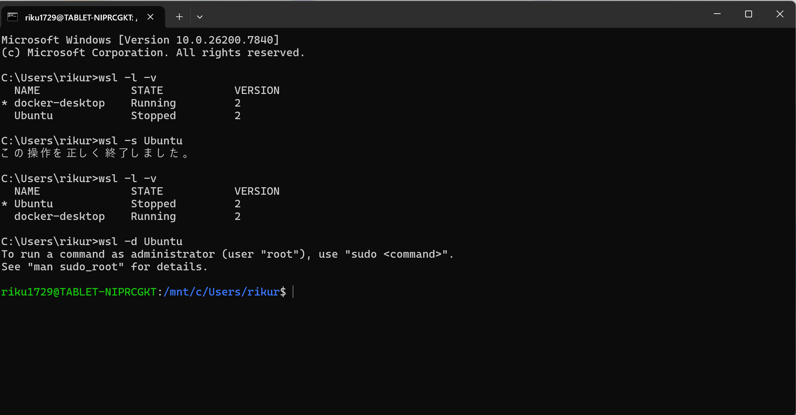
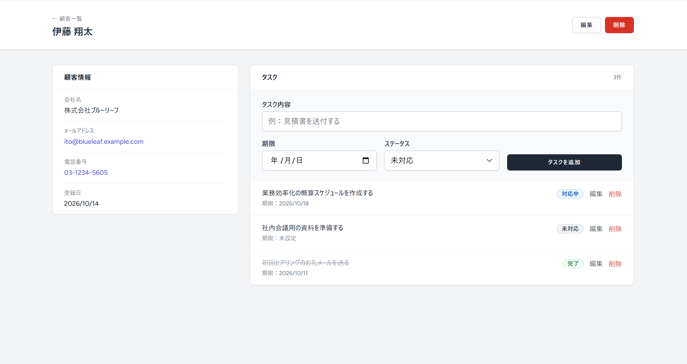

# 簡易CRM（顧客管理 × タスク管理）

顧客情報と、顧客ごとのタスクを一元管理できる、Laravel製のWebアプリケーションです。
ポートフォリオ（実績）として制作しました。

## スクリーンショット

| 顧客一覧 | 顧客詳細（タスク管理） |
| --- | --- |
|  |  |

## 主な機能

- **ログイン / 新規登録 / ログアウト**（Laravel Breeze）
- **顧客管理（CRUD）**：顧客名・会社名・メール・電話の登録、一覧、詳細、編集、削除
- **顧客の検索**：名前・会社名・メールアドレスで絞り込み
- **タスク管理**：顧客詳細画面からタスクを追加・編集・削除
  - ステータス：未対応 / 対応中 / 完了
  - 期限切れの未完了タスクを赤字で強調
- **一覧画面で未完了タスク数を表示**
- **アクセス制限**：ログイン中のユーザーは自分が登録した顧客・タスクのみ閲覧・操作可能（Policyで制御）
- **レスポンシブ対応**（Tailwind CSS）

## 使用技術

| 項目 | 内容 |
| --- | --- |
| バックエンド | PHP / Laravel 11 |
| 認証 | Laravel Breeze（Blade） |
| フロントエンド | Blade / Tailwind CSS / Vite |
| データベース | SQLite（MySQLへの切り替えも可能） |

## 設計のポイント

- **ステータスはEnumで管理**：`TaskStatus`（PHP 8.1のbacked enum）に値と日本語ラベルを集約し、画面・バリデーション・DB保存で同じ定義を使用
- **認可はPolicyで実装**：`CustomerPolicy` / `TaskPolicy` により、URLを直接指定しても他ユーザーのデータは開けない
- **N+1を避けた一覧**：未完了タスク数は `withCount` でまとめて取得
- **共通化**：顧客の入力フォームやステータスバッジはBladeコンポーネント・部分テンプレートに切り出し

## ER図

```
users 1 ──< customers 1 ──< tasks
```

- `customers.user_id` → `users.id`
- `tasks.customer_id` → `customers.id`（顧客削除時はタスクも削除）

## セットアップ

必要環境：PHP 8.2以上 / Composer / Node.js

```bash
git clone https://github.com/Riku-1020-0302/laravel-test.git
cd laravel-test

composer install
npm install

cp .env.example .env
php artisan key:generate

touch database/database.sqlite   # SQLiteを使う場合
php artisan migrate

# デモデータ（架空の顧客5件＋タスク）を投入
php artisan db:seed --class=DemoSeeder
```

起動（ターミナルを2つ使います）

```bash
npm run dev          # 1つ目
php artisan serve    # 2つ目
```

ブラウザで http://localhost:8000 を開いてください。

### デモアカウント

| メールアドレス | パスワード |
| --- | --- |
| demo@example.com | password |

※ デモデータの会社名・氏名・連絡先はすべて架空のものです。
※ 公開環境で使う場合は、`database/seeders/DemoSeeder.php` のパスワードを変更してください。

## ディレクトリ構成（主要部分）

```
app/
├── Enums/TaskStatus.php
├── Http/Controllers/{CustomerController,TaskController}.php
├── Models/{User,Customer,Task}.php
└── Policies/{CustomerPolicy,TaskPolicy}.php
database/
├── migrations/
└── seeders/DemoSeeder.php
resources/views/
├── customers/   # index, show, create, edit, _form
├── tasks/       # edit
└── components/  # status-badge, flash-message
routes/web.php
```

## 今後の拡張案

- タスクのステータス絞り込み・並び替え
- ダッシュボード（期限が近いタスクの一覧）
- 顧客へのメモ・対応履歴
- CSVエクスポート
- Featureテストの追加